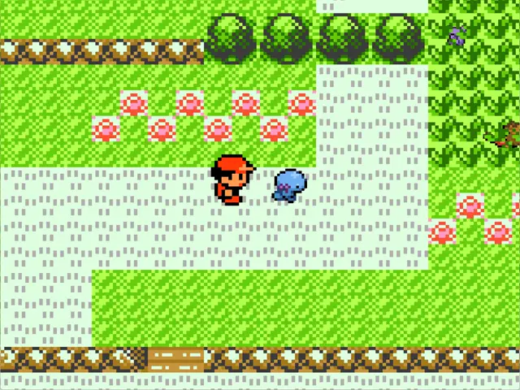
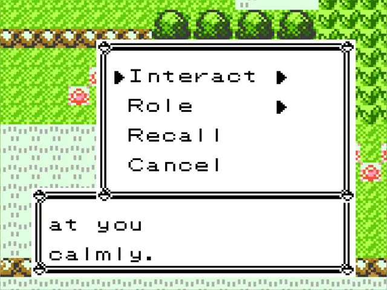
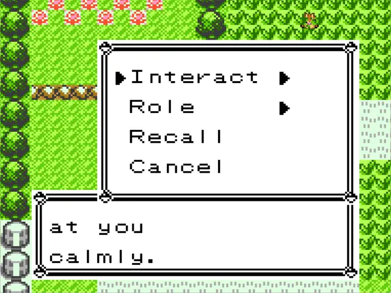

# Vivid Worlds: OG 🌿

*Kanto and Johto come alive. Wild Pokémon roam the overworld of Red, Blue, Yellow, Gold,
Silver and Crystal, and a partner Pokémon walks with you, battles at your side and digs up
treasure.*

A mod for [Gen1Recomp](https://github.com/bryanthaboi/gen1recomp), for its Generation 1 and 2
games. A lightweight sister to **Vivid Worlds** (Wilds of Hoenn).

<table>
<tr>
<td align="center" width="33%"></td>
<td align="center" width="33%"></td>
<td align="center" width="33%"></td>
</tr>
<tr>
<td align="center"><b>Pet, Play, Talk</b> Turn to your partner and press A; its mood shows in the game's own emote bubbles.</td>
<td align="center"><b>Battle</b> Give it the Battler role and it takes on the wild Pokémon around you, earning EXP.</td>
<td align="center"><b>Forage</b> Give it the Forager role and it digs up an item every 60 steps you take.</td>
</tr>
</table>

## ✨ Features

- 🦌 **Wild Pokémon in the overworld:** Areas with wild encounters fill with visible Pokémon
  wandering the grass and swimming the water. Walk onto one to battle it, the very Pokémon you
  saw. On land they only appear where you can actually walk to: never in a cave pocket you can't
  get into or on the far side of a ledge you can't climb.
- 🌾 **The grass moves:** In Gold, Silver and Crystal the tall grass rustles as wild Pokémon walk
  through it.
- 🌿 **They arrive, they don't pop in:** new Pokémon rise out of the grass, surface from the
  water, or fade in on bare ground, and leave the same way.
- 🎲 **Classic encounters, your call:** Keep the original step-based encounters in grass, caves
  and on Surf alongside the visible ones, or only meet what you can see. Fishing, the
  Bug-Catching Contest and Sweet Scent work as always.
- 😮 **They react to you:** Bike past (or run, with a running shoes mod) and weaker Pokémon
  get startled and run off, while stronger ones get angry and chase you down. Walking disturbs
  nobody, except in the Safari Zone.
- ✨ **Shinies you can spot:** Set how often wild Pokémon are shiny, from the original 1 in 8192
  up to always. A shiny out in the grass shows its shiny colours with a twinkle, is the same
  shiny when you battle it, and stays shiny once caught. Red, Blue and Yellow battles greet a
  shiny with a sparkle and a chime; Gold, Silver and Crystal flash it the way they always have.
  The rate covers every wild Pokémon, including random encounters, fishing and Headbutt.

- 🐺 **Roaming legends:** In Gold, Silver and Crystal, Raikou, Entei and Suicune can turn up
  among the wild Pokémon on whichever route they are roaming, as often as the game would send
  them at you. Walk into one for the real roaming battle: it keeps its HP, flees and moves on
  just like in the game, and once caught it is gone for good.
- 🔤 **Unown letters:** In the Ruins of Alph each Unown shows its own letter, the one you then
  battle and catch, and only letters you have unlocked turn up.
- 👻 **Pokémon Tower ghosts:** Until you have the Silph Scope, every wild Pokémon in the Tower
  is a ghost you can't make out, out in the corridors and in battle. With the scope you see
  what they really are.
- 🦓 **Skittish Safari Pokémon:** In Red, Blue and Yellow's Safari Zone wild Pokémon may bolt
  when you walk near, as readily as they run from a Safari battle: the faster the species, the
  jumpier. None of them ever chase you.

## 📖 More

- 🐾 [Your Partner](docs/PARTNER.md): roles, overworld battles, foraging, and Pet / Play / Talk.
- ⚙️ [Options](docs/OPTIONS.md): every setting, its choices and its default.
- 🔗 [Works With](docs/WORKS_WITH.md): Modern Spawns, WoobleView and the 3D world mods.
- 📌 [Good to Know](docs/GOOD_TO_KNOW.md): the Safari Zone, roaming legends, shinies and more.
- 🪪 [Credits](docs/CREDITS.md): who made the art and ideas this mod is built on.

## 💾 Installation

1. Download `vivid-worlds-og-v*.zip` from the
   [Releases](https://github.com/poooooby/vivid-worlds-og/releases) page (not the "Source code"
   ZIP).
2. Import it with the Gen1Recomp Mod Manager, or drop it in your mods folder.
3. Enable **Vivid Worlds: OG**.

---

Licence: [LICENSE](LICENSE) · Art credits: [THIRD_PARTY_NOTICES.md](THIRD_PARTY_NOTICES.md) ·
Release history: [CHANGELOG.md](CHANGELOG.md) · Working on the mod? See
[DEVELOPMENT.md](DEVELOPMENT.md).
